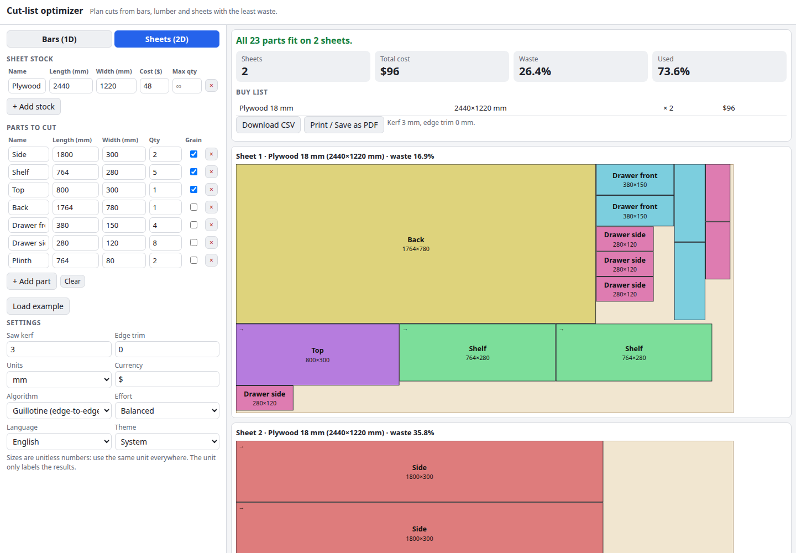

# Cut-List Optimizer

Plan your cuts with the least waste. Enter the parts you need and the stock you can buy, and the optimizer packs them into lumber bars (1D) or plywood sheets (2D), allowing for the saw kerf, edge trim, stock prices and grain direction. You get cutting diagrams, a buy list, the waste percentage and a CSV or printable PDF. Everything runs in your browser.

**Try it: [hermes98761234.github.io/cut-list-optimizer](https://hermes98761234.github.io/cut-list-optimizer/)**

[](https://github.com/hermes98761234/cut-list-optimizer/actions/workflows/deploy.yml)



## Features

- **1D bars and lumber** with kerf between cuts and trim at both ends.
- **2D sheets** with two packers: *guillotine* (every cut runs edge to edge, so a panel saw or table saw can do it) and *MaxRects* (tighter, for CNC or nesting).
- **Several stock sizes with costs and optional quantity limits.** The optimizer picks the mix with the lowest total cost, and swaps a nearly empty last bar or sheet for a smaller, cheaper one.
- **Grain direction:** mark a part to keep its length along the sheet and it is never rotated. Other parts may rotate 90°.
- **Results you can use:** to-scale diagrams, per-bar and per-sheet waste, buy list with cost, CSV export, and a print layout that saves cleanly as PDF.
- **Examples on first load**, English and Ukrainian, light/dark/system theme. Inputs are remembered in the browser. No tracking, nothing is uploaded.

## How it works

The problem is NP-hard, so the optimizer is a heuristic. It builds many layouts and keeps the best one by unplaced parts, then total cost, then number of bars or sheets, then the stock area used.

- **Bars:** first/best-fit decreasing over the sorted parts and many seeded random re-orderings. A new bar gets the stock size with the lowest cost per length used when filled greedily. A part needs one kerf to its neighbour: `sum(lengths) + kerf × (n − 1) ≤ length − 2 × trim`.
- **Sheets:** parts are placed into free rectangles by best short side fit, best long side fit, best area fit (and bottom-left for MaxRects), over several sort orders and random re-orderings. Guillotine keeps disjoint free rectangles and splits them with a kerf gap on the shorter or longer leftover axis. MaxRects keeps overlapping maximal free rectangles and handles the kerf by growing the sheet and every part by one kerf.
- The search runs in a Web Worker and uses a fixed seed, so the same input always gives the same plan. The *Effort* setting changes how many random orderings are tried.

Results are good, not guaranteed optimal. The unit tests check that every layout stays inside the stock, that parts never overlap and are one kerf apart, that grain-locked parts are not rotated, and that perfect-fit cases (for example four quarter-sheets) reach 0% waste.

## Quick start

You need [Node.js](https://nodejs.org/) 22.

```bash
git clone https://github.com/hermes98761234/cut-list-optimizer.git
cd cut-list-optimizer
npm install
npm run dev       # http://localhost:5173
npm test          # packers, CSV and i18n tests
npm run build     # static site in dist/
```

## License

MIT
